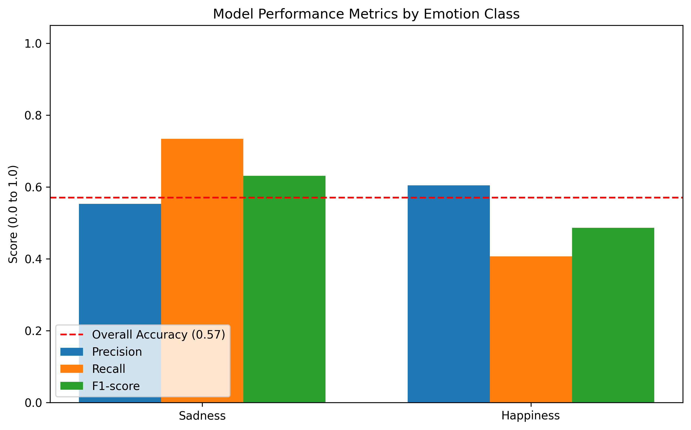

# 🧠 EAV-Project (EEG-Audio-Video Emotion Recognition)

A high-performance Multimodal Machine Learning Pipeline designed to interpret human emotions (Sadness vs. Happiness) by synchronizing brainwave telemetry, visual facial geometry, and verbal audio frequency analysis.

This repository features an Apple Silicon Native, PyTorch-based neural network leveraging **Cross-Sensory Bidirectional Long Short-Term Memory (LSTM)** sequence tracking and **Self-Attention** modules to mathematically model the progression of human expression over a 5-second window.

For a complete explanation of the architecture, data flow, fuzzy inference
system, training protocol, evaluation baselines, robustness experiments, and
limitations, see [Complete Project Documentation](docs/PROJECT_DOCUMENTATION.md).

For a shorter, presentation-friendly explanation of only the fuzzy extension,
see [Simple Fuzzy Fusion Guide](docs/FUZZY_FUSION_SIMPLE_GUIDE.md).



---

## 🗂️ Project Structure

*   `src/data/`: Contains the data-loading engines pipeline (EEG, Vision, and Audio loaders) built to serialize continuous streams of multi-sensory data directly into standard PyTorch `DataLoader` objects.
*   `src/models/`: Houses the mathematical architecture classes, including `multimodal_model.py` which defines the exact topological configuration.
*   `src/scripts/`: Features the active processing loops `train_multimodal.py` and `evaluate_model.py`.
*   `docs/images/`: Automatically generated visualizations charting Confusion Matrices, Precision Metrics, and ROC/AUC scores.
*   `best_multimodal_model.pth`: The ultra-lightweight (1.6 MB) actively trained Neural Network weights!

---

## ⚙️ Model Architecture & Topology

To prevent standard frame "signal blurring," this framework structurally ignores simplistic Global Pool averaging and instead opts to model sequential states. 

The architecture is explicitly defined as a **Late-Fusion Tri-Branch Network** with parallel expert pathways.

### 1. The Brainwave Expert (EEG Branch)
*   **Input Dimension:** `(Batch, Channels=30, Time=500)`
*   **Spatial Feature Extraction:** Two massive `Conv1D` spatial filters pass longitudinally across the 30 sensors to isolate localized brain spikes, halving spatial noise via `MaxPool1D`.
*   **Temporal Memory (`LSTM`):** Extracted states pass into a `Bidirectional LSTM` tracking `64` internal dimensions, analyzing the brainwaves forward and chronologically in reverse `(out_dim=128)`.
*   **Temporal Focus (`SelfAttention`):** Computationally isolates millisecond-exact points of emotional climax, mathematically ignoring dormant "baseline" brainplateaus.
*   **Vector Return:** Linear projection to `(128)`.

### 2. The Vocal Expert (Audio Branch)
*   **Input Dimension:** `(Batch, 80000)` raw Hz waveform.
*   **Heat-mapping:** Synthesizes `torchaudio.MelSpectrogram` images (`64 n_mels`). Uses an Apple Silicon MPS fallback override to push FFT limits perfectly via CPU routing.
*   **Convolution Integration:** Analyzes the spectrogram through `16->32->64` Convolutional layers exactly like a static photograph.
*   **Chronological Tracking (`LSTM`):** Reshapes the topological axes algorithmically (`B, Time, 64`) to preserve chronological continuity, feeding the acoustic shifts into a `Bidirectional LSTM`.
*   **Temporal Focus (`SelfAttention`):** Scales highest mathematical weight to precise changes in pitch and acoustic wavering.
*   **Vector Return:** Linear projection to `(128)`.

### 3. The Visual Expert (Video Branch)
*   **Input Dimension:** `(Batch, Frames=25, Channels=3, H=56, W=56)`
*   **Feature Tracing:** Uses a lightweight custom sequence `Conv2D` filter across every solitary facial frame simultaneously. 
*   **Chronological Tracking (`LSTM`):** Fuses the translated visual grids `(B, 25, 64)` sequentially into a `Bidirectional LSTM`. The network interprets *the progression of a smile/frown over 25 frames*, rather than attempting to statically decode an average pixel pool.
*   **Temporal Focus (`SelfAttention`):** Automatically locates the specific sequence frame representing the maximum arc of a smile or expression.
*   **Vector Return:** Linear projection to `(128)`.

### 🏁 Late Fusion & Classification Console
Outputs from all three expert mechanisms are flattened and concatenated to form a single master array `(128 + 128 + 128 = 384)`.
This fusion array runs through a dense, volatile `3-Layer MLP` protected heavily by Dropout functions (`0.5`, `0.3`) to aggressively prevent memorization vectors. 

The final `num_classes=2` calculation mathematically determines if the network evaluates the synchronized brain, face, and audio combination as 0 (Sad) or 1 (Happy).

---

## Adaptive Fuzzy Decision-Level Fusion

The original 384-dimensional concatenation classifier remains unchanged and is
still the primary baseline. The extension adds three independent linear heads:

```text
EEG/Audio/Video expert (128-D) -> modality head -> [P(Sad), P(Happy)]
                                              \-> Mamdani reliability FIS
                                              \-> weighted final probability
```

The heads are stored in `modality_heads.pth`, separately from
`best_multimodal_model.pth`. Consequently, the original checkpoint keys and
`EAVMultimodalFusionNetwork.forward()` API remain compatible.

### Fuzzy inputs

For modality \(m\), confidence is the requested binary-softmax maximum:

\[
C_m = \max_c p_m(c), \qquad C_m \in [0.5, 1].
\]

Cross-modal disagreement is the mean of the three pairwise total-variation
distances:

\[
D = \frac{TV(p_e,p_a)+TV(p_e,p_v)+TV(p_a,p_v)}{3},\qquad
TV(p,q)=\frac{1}{2}\sum_c |p(c)-q(c)|.
\]

This produces a normalized value in `[0, 1]`. The FIS never receives the
384-D latent vector.

### Membership functions and rules

Confidence uses overlapping Low/Medium/High sets on `[0.5, 1]`, centered at
`0.50`, `0.75`, and `1.00`. Disagreement and output reliability use
overlapping shoulder/triangular sets on `[0, 1]`, centered at `0.00`, `0.50`,
and `1.00`. Exact breakpoints are in
`src/fuzzy/membership_functions.py`.

`src/fuzzy/fuzzy_rules.py` generates an exhaustive `3^4 = 81`-rule table:
every EEG-confidence, audio-confidence, video-confidence, and disagreement
linguistic combination is covered. Low/medium disagreement preserves the
confidence-derived reliability. With high disagreement, a unique
most-confident expert is retained while alternatives are reduced one level;
when leaders tie, tied experts are conservatively reduced because a single
global disagreement value cannot identify which equally confident expert is
wrong.

Inference uses Mamdani minimum for AND/implication, maximum aggregation, and
centroid defuzzification over 1,001 output points. Crisp weights are normalized
using one denominator before probability fusion:

\[
\hat p = w_e p_e + w_a p_a + w_v p_v,\qquad
w_e+w_a+w_v=1.
\]

The implementation is deterministic and has no learned FIS parameters.
Head training records validation accuracy, mean confidence, and 10-bin expected
calibration error for each modality in `modality_heads.pth`; these diagnostics
inspect confidence without fitting anything on test.

### Leakage-safe experiment protocol

For each subject and class, the final 30% remains the untouched historical
test partition. The first 70% development region is split deterministically
into training and validation subsets. Model/head selection and the fixed
fusion weights use validation data only. The fixed-weight baseline normalizes
the three validation accuracies; fuzzy rules and membership breakpoints are
not fitted on test.

The original training script used the 30% partition for checkpoint selection.
Therefore, the supplied historical `best_multimodal_model.pth` is useful for
compatibility experiments but must not be presented as a clean final test
result. Retrain it with the updated script for a leakage-free report.

### Supported preprocessed data layout

The original `src/data` package was missing from this repository. The restored
loader deliberately consumes preprocessed synchronized arrays and does not
silently recreate or alter the original EEG/audio/video preprocessing.

Preferred per-subject files:

```text
data/Inputs/Multimodal/subject_01.npz
  keys: eeg, audio, video, labels
```

Separate historical pickles are also supported under
`data/Inputs/{EEG,Audio,Vision}/subject_01_{eeg,aud,vis}.pkl`. They may contain
`(x, y)` or `(train_x, train_y, test_x, test_y)`. Labels must align exactly.
Expected tensors remain EEG `(N,30,500)`, audio `(N,80000)`, and video
`(N,25,3,56,56)`. The existing mapping is preserved: original label `1` is
Sad (`0`) and original label `3` is Happy (`1`).

## 🚀 Quickstart Guide

**1. Set up your Virtual Environment**
Ensure the project remains totally isolated on your machine:
```bash
python3 -m venv .venv
source .venv/bin/activate
pip install -r requirements.txt
export PYTHONPATH="."
```

*(Note: If you have active Zenodo data arrays structured into individual subject folders, place them directly inside a `/data` folder at the root directory! This folder is explicitly .gitignored!)*

**2. Train a clean original baseline**
```bash
python3 src/scripts/train_multimodal.py --data-root data
```

**3. Train only the modality heads (encoders stay frozen)**
```bash
python3 src/scripts/train_modality_heads.py \
  --data-root data \
  --baseline-checkpoint best_multimodal_model.pth
```

**4. Evaluate all seven methods**
```bash
python3 src/scripts/evaluate_fuzzy_fusion.py \
  --data-root data \
  --baseline-checkpoint best_multimodal_model.pth \
  --heads-checkpoint modality_heads.pth
```

This writes JSON/CSV metrics, per-class results, ROC-AUC, seven confusion
matrices, and representative fuzzy weights to `docs/fuzzy_results/`.

**5. Run controlled robustness experiments**
```bash
python3 src/scripts/evaluate_fuzzy_fusion.py \
  --data-root data \
  --robustness
```

The deterministic conditions are audio/EEG noise, video downsample/upsample,
zero-masked modalities, and a reversed audio probability distribution. The
report records actual accuracy and mean fuzzy weights for every condition.
Input corruption is not guaranteed to lower neural confidence, so results—not
assumptions—must determine whether fuzzy fusion helped.

**6. Run fuzzy unit tests**
```bash
python3 -m unittest tests/test_fuzzy_inference.py
```

**7. View Direct System Tensor Topology**
To view the microscopic breakdown and sequence parameter sizes line-by-line of the entire Neural Network:
```bash
python3 src/scripts/print_architecture.py
```
